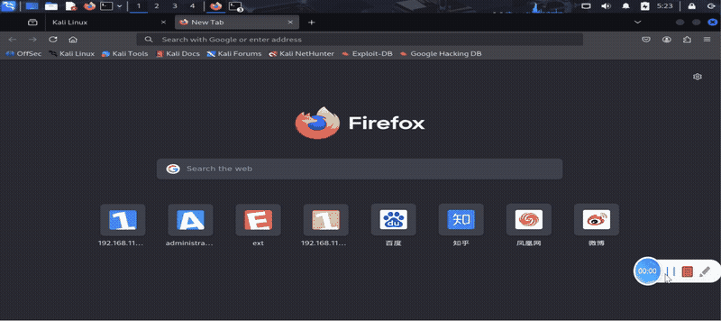
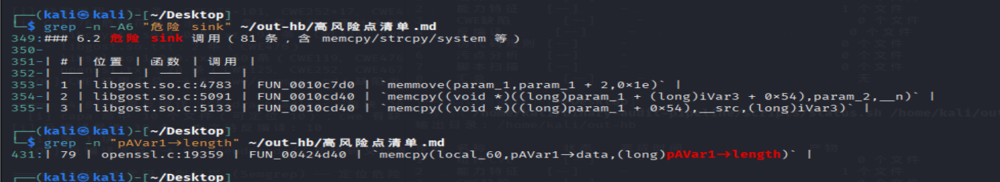
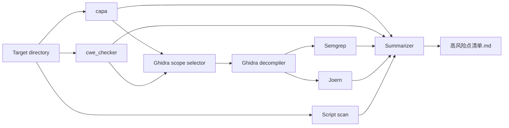

# binary-audit-pipeline

**English** | [简体中文](README.zh-CN.md)

> One command to turn a directory of stripped binaries into a prioritized
> vulnerability report: capabilities, CWE defects, decompiled code,
> taint flows, and next-step fuzz targets.

<p align="center">
  
</p>

## Why this exists

When you only have binaries and no source, the usual workflow is: run `capa`,
run `cwe_checker`, open Ghidra, run Semgrep on the decompiled code, run Joern
for taint analysis, then manually merge five different output formats. This
project wires those tools together and produces one prioritized Markdown
report.

It is not a fuzzer and it does not execute the target. It is a static triage
pipeline that tells you where to look first.

## What it does

| Step | Tool | Purpose | Default |
| --- | --- | --- | --- |
| 1 | cve-bin-tool | Known CVE lookup by version | off |
| 2 | capa | Capability detection: files -> functions -> rules | on |
| 3 | cwe_checker | CWE defects, separating real findings from CWE676 hints | on |
| 4 | Ghidra | Decompile only files hit by capa/CWE (`GHIDRA_SCOPE=hits`) | on |
| 5 | Semgrep | Scan decompiled pseudocode with local rules | on |
| 6 | Joern | Source-to-sink taint flows with file, function, line and code | on |
| 7 | Semgrep + Bandit + njsscan | Check shell/Python/JS scripts for dangerous calls | on |
| 8 | summarize | Build `高风险点清单.md` (prioritized report) | on |

Key behaviours:

- Ghidra only decompiles files that capa or cwe_checker flagged; if nothing is
  flagged, it falls back to all files.
- CWE output distinguishes real defects from the almost-always-present CWE676
  dangerous-symbol hint.
- Joern output includes the source file, function, line number and code snippet
  for every flow; single-node self-loops and source functions in the sink list
  are filtered out.
- The report includes a dedicated dangerous-sink table, so `memcpy`, `strcpy`,
  `system` and similar calls are easy to locate.

## How the steps connect

The eight steps are a funnel, not a checklist. Each one narrows the scope for
the next:

1. **CVE lookup** (optional) matches library versions against known CVEs.
2. **capa and cwe_checker** scan every file in the target directory. capa
   reports capabilities (network I/O, file handling, encoding/decoding,
   crypto); cwe_checker reports memory-safety and other CWE defects.
3. The files flagged by either tool are **deduplicated** and become the
   **Ghidra scope**. Everything else is skipped, so a few thousand functions
   collapse into a few hundred. If nothing is flagged, Ghidra falls back to
   all files.
4. **Semgrep** runs over the decompiled pseudocode and keeps dangerous
   patterns; only its hits become the **Joern scope**.
5. **Joern** re-checks those candidates and confirms whether untrusted input
   actually reaches a sink, with file, function and line.
6. In parallel, **Semgrep + Bandit + njsscan** scan the shell, Python and
   JavaScript files found in the target directory.
7. The **summarizer** merges everything into `高风险点清单.md`.

Every step writes its raw output to its own numbered directory (`01_cve`,
`02_capa`, ...). That is what makes a run resumable, allows a single step to be
re-run with `--only`, and lets you hand the whole `out/` directory to an AI or a
colleague for the next round of analysis.

## Quick start

### Docker

```bash
docker pull ghcr.io/spiralrise/binary-audit-pipeline:1.1.0

python3 audit.py /path/to/firmware /path/to/out
```

`audit.py` is a small wrapper around `docker run`. It mounts the input directory
read-only, mounts the output directory, and passes the usual environment
variables.

### Raw docker command

```bash
docker run --rm --entrypoint sh \
  -e WITH_JOERN=1 \
  -e GHIDRA_SCOPE=hits \
  -v /path/to/firmware:/work/targets:ro \
  -v /path/to/out:/work/out \
  ghcr.io/spiralrise/binary-audit-pipeline:1.1.0 \
  /opt/pipeline/scripts/pipeline.sh /work/targets /work/out
```

### Offline

```bash
zstd -d binary-audit-pipeline.tar.zst -c | docker load
tar xzf binary-audit-pipeline-tools.tar.gz
python3 audit.py /path/to/samples /path/to/out
```

The offline bundle is not stored in this repository because of its size; create
one with `docker save binary-audit-pipeline:1.1.0 | zstd -T0 -10 -o binary-audit-pipeline.tar.zst`.

## Requirements

- Docker Engine 20.10+ (or Docker Desktop).
- About 10 GB of free disk for the image and the output directory.
- 4 CPU cores are enough for medium-sized binaries.
- 8 GB RAM minimum, 16 GB recommended; Ghidra and Joern are memory-hungry.

## Performance

Measured on a 4-core / 16 GB virtual machine: a stripped `libssl.so.1.0.0` from
Ubuntu 12.04 (OpenSSL 1.0.1c, about 8,700 functions) takes roughly **25 minutes**
end to end with Joern enabled. Ghidra decompilation and Joern taint analysis
dominate the runtime; the other steps take a couple of minutes in total.

Because each step caches its output, an interrupted run resumes where it
stopped, and `--only 8` re-runs just the summarizer.

## Output

The main report is `out/高风险点清单.md`. It contains, among other sections:

- capability hits grouped by file, rule and function;
- CWE findings with the CWE676 hint separated;
- decompiled function inventory;
- Semgrep findings;
- script-scan findings (Semgrep, Bandit, njsscan);
- Joern taint flows grouped by source file;
- a dangerous-sink table.

Raw tool output is kept under `out/01_cve`, `out/02_capa`, and so on, so you can
inspect the original JSON at any time.



## Architecture



### Design notes: a funnel, not a fan-out

Running all five tools over everything and merging the output sounds simpler,
but the noise is unmanageable in practice: cwe_checker reports CWE676 on almost
every ELF, full decompilation of a single `libssl.so` means 8,000+ functions,
and building a Joern CPG for every function runs out of memory.

Three decisions keep runtime and the report readable:

1. **Ghidra only decompiles what capa or cwe_checker flagged.** If neither
   flags anything, it falls back to all files.
2. **Joern only builds a graph for the pseudocode Semgrep selected.** Semgrep
   answers "is there a dangerous call here"; Joern answers "can external input
   reach it".
3. **Every step writes to its own numbered directory**, so a run can resume, a
   single step can be re-run, and the raw JSON stays available for a human or
   an AI to re-read later.

Things that bit us along the way: every tool speaks a different JSON dialect
(so there is one intermediate record shape), CWE676 drowns out real defects (so
it is counted separately), and pseudocode line numbers are not source line
numbers (the report says so explicitly).

## From audit to fuzz

Static triage is only useful if it leads to the next step. This repository ships
with a prompt template, [`prompts/fuzz-plan.md`](prompts/fuzz-plan.md), that you
can give to an AI together with the whole `out/` directory. It asks the model to:

1. check whether the target directory contains archives or firmware images that
   need `binwalk`;
2. read the capa, CWE, Semgrep, Joern and script-scan outputs;
3. rank candidate functions for fuzzing;
4. suggest a harness (AFL++ / libFuzzer) and the input format;
5. list files that were not covered by the pipeline.

The same instructions are packaged as an agent skill in
[`skills/binary-audit-triage/SKILL.md`](skills/binary-audit-triage/SKILL.md),
for runtimes that load skills automatically.

## Case study

[`examples/heartbleed/`](examples/heartbleed/) runs the pipeline on a stripped
OpenSSL 1.0.1c binary (the Heartbleed version). 88 files in, 10 decompiled
files and 8,735 functions, 33 taint flows, 81 dangerous sinks. The page
includes terminal screenshots and explains what the result does and does not
prove.

## Limitations

- Static analysis only; findings need manual confirmation.
- The target is never executed. This is not a fuzzer.
- Packed or obfuscated binaries need unpacking first.
- ZIP archives and firmware images need to be extracted with `binwalk` before
  running the pipeline.
- Joern only sees the scope selected by Semgrep, not every function.
- Decompiler output is not original source; line numbers refer to the generated
  pseudocode.

## Repository layout

```text
audit.py            host-side wrapper around docker run
scripts/            pipeline and helper scripts
ghidra_scripts/     Ghidra headless export script
rules/local/        Semgrep rules for decompiled code
cwe_pcode/          patched cwe_checker p-code extractor (Ghidra 12.x)
samples/            small demo binary source
prompts/            AI handoff prompts
skills/             agent skills (auto-loaded by skill-aware runtimes)
examples/           case studies (e.g. Heartbleed)
docs/               screenshots and diagrams
LICENSE
THIRD_PARTY_LICENSES.md
CONTRIBUTING.md
```

## Contributing

Issues and pull requests are welcome. The pipeline is a set of shell and Python
scripts under `scripts/`, and each step is independent, so a fix usually touches
only one file.

- Open an issue first for anything larger than a bug fix.
- Put new behaviour behind an environment variable, the way the existing
  `WITH_*` and `GHIDRA_SCOPE` switches work, so the default path stays the same.
- Test on a small directory (a handful of ELF files) before opening a PR.

See [`CONTRIBUTING.md`](CONTRIBUTING.md) for details.

## License

MIT. Third-party tools and rules keep their own licenses; see
[`THIRD_PARTY_LICENSES.md`](THIRD_PARTY_LICENSES.md).

## Disclaimer

This project is intended for authorized security testing and research. Do not
use it against systems you do not own or have permission to test.

---

Author: SpiralRise
