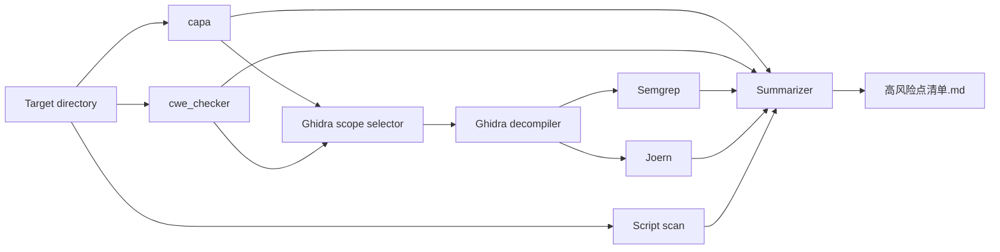

# binary-audit-pipeline

**English** | [简体中文](README.zh-CN.md)

> One command to turn a directory of stripped binaries into a prioritized
> vulnerability report: capabilities, CWE defects, decompiled code,
> taint flows, and next-step fuzz targets.

<!-- TODO: add docs/demo.gif and replace this comment with the image link. -->

## Why this exists

When you only have binaries and no source, the usual workflow is: run `capa`,
run `cwe_checker`, open Ghidra, run Semgrep on the decompiled code, run Joern
for taint analysis, then manually merge five different output formats. This
project wires those tools together and produces one prioritized Markdown
report.

It is not a fuzzer and it does not execute the target. It is a static triage
pipeline that tells you where to look first.

## What it does

| Step | Tool | Purpose | Default |
| --- | --- | --- | --- |
| 1 | cve-bin-tool | Known CVE lookup by version | off |
| 2 | capa | Capability detection: files -> functions -> rules | on |
| 3 | cwe_checker | CWE defects, separating real findings from CWE676 hints | on |
| 4 | Ghidra | Decompile only files hit by capa/CWE (`GHIDRA_SCOPE=hits`) | on |
| 5 | Semgrep | Scan decompiled pseudocode with local rules | on |
| 6 | Joern | Source-to-sink taint flows with file, function, line and code | on |
| 7 | Semgrep + Bandit + njsscan | Check shell/Python/JS scripts for dangerous calls | on |
| 8 | summarize | Build `高风险点清单.md` (prioritized report) | on |

Key behaviours:

- Ghidra only decompiles files that capa or cwe_checker flagged; if nothing is
  flagged, it falls back to all files.
- CWE output distinguishes real defects from the almost-always-present CWE676
  dangerous-symbol hint.
- Joern output includes the source file, function, line number and code snippet
  for every flow; single-node self-loops and source functions in the sink list
  are filtered out.
- The report includes a dedicated dangerous-sink table, so `memcpy`, `strcpy`,
  `system` and similar calls are easy to locate.

## Quick start

### Docker

```bash
docker pull ghcr.io/spiralrise/binary-audit-pipeline:1.1.0

python3 audit.py /path/to/firmware /path/to/out
```

`audit.py` is a small wrapper around `docker run`. It mounts the input directory
read-only, mounts the output directory, and passes the usual environment
variables.

### Raw docker command

```bash
docker run --rm --entrypoint sh \
  -e WITH_JOERN=1 \
  -e GHIDRA_SCOPE=hits \
  -v /path/to/firmware:/work/targets:ro \
  -v /path/to/out:/work/out \
  ghcr.io/spiralrise/binary-audit-pipeline:1.1.0 \
  /opt/pipeline/scripts/pipeline.sh /work/targets /work/out
```

### Offline

```bash
zstd -d binary-audit-pipeline.tar.zst -c | docker load
tar xzf binary-audit-pipeline-tools.tar.gz
python3 audit.py /path/to/samples /path/to/out
```

The offline bundle is not stored in this repository because of its size; create
one with `docker save binary-audit-pipeline:1.1.0 | zstd -T0 -10 -o binary-audit-pipeline.tar.zst`.

## Requirements

- Docker Engine 20.10+ (or Docker Desktop).
- About 10 GB of free disk for the image and the output directory.
- 8 GB RAM recommended; Ghidra and Joern are memory-hungry.
- Joern is the slowest step; expect longer runtimes on large binaries.

## Output

The main report is `out/高风险点清单.md`. It contains, among other sections:

- capability hits grouped by file, rule and function;
- CWE findings with the CWE676 hint separated;
- decompiled function inventory;
- Semgrep findings;
- script-scan findings (Semgrep, Bandit, njsscan);
- Joern taint flows grouped by source file;
- a dangerous-sink table.

Raw tool output is kept under `out/01_cve`, `out/02_capa`, and so on, so you can
inspect the original JSON at any time.

## Architecture



## From audit to fuzz

Static triage is only useful if it leads to the next step. This repository ships
with a prompt template, [`prompts/fuzz-plan.md`](prompts/fuzz-plan.md), that you
can give to an AI together with the whole `out/` directory. It asks the model to:

1. check whether the target directory contains archives or firmware images that
   need `binwalk`;
2. read the capa, CWE, Semgrep, Joern and script-scan outputs;
3. rank candidate functions for fuzzing;
4. suggest a harness (AFL++ / libFuzzer) and the input format;
5. list files that were not covered by the pipeline.

## Limitations

- Static analysis only; findings need manual confirmation.
- The target is never executed. This is not a fuzzer.
- Packed or obfuscated binaries need unpacking first.
- ZIP archives and firmware images need to be extracted with `binwalk` before
  running the pipeline.
- Joern only sees the scope selected by Semgrep, not every function.
- Decompiler output is not original source; line numbers refer to the generated
  pseudocode.

## Repository layout

```text
audit.py            host-side wrapper around docker run
scripts/            pipeline and helper scripts
ghidra_scripts/     Ghidra headless export script
rules/local/        Semgrep rules for decompiled code
cwe_pcode/          patched cwe_checker p-code extractor (Ghidra 12.x)
samples/            small demo binary source
prompts/            AI handoff prompts
examples/           case studies (e.g. Heartbleed)
docs/               screenshots and diagrams
LICENSE
THIRD_PARTY_LICENSES.md
```

## License

MIT. Third-party tools and rules keep their own licenses; see
[`THIRD_PARTY_LICENSES.md`](THIRD_PARTY_LICENSES.md).

## Disclaimer

This project is intended for authorized security testing and research. Do not
use it against systems you do not own or have permission to test.
