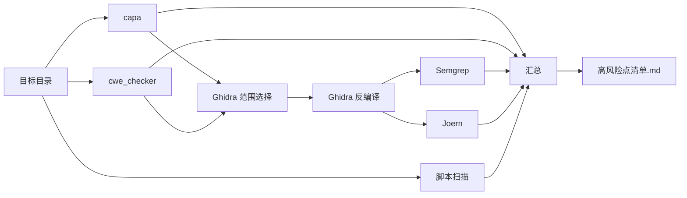

# binary-audit-pipeline

[English](README.md) | **简体中文**

> 一条命令，把无源码二进制目录变成一份按优先级排序的高风险点清单：
> 能力特征、CWE 缺陷、反编译代码、污点路径，以及下一步 fuzz 建议。

<!-- TODO: 添加 docs/demo.gif 后，把这条注释替换成图片链接。 -->

## 为什么做这个

只有二进制、没有源码时，常见流程是：跑 capa、跑 cwe_checker、打开 Ghidra、
对伪代码跑 Semgrep、再跑 Joern 做污点分析，最后手工合并五种输出。
这个项目把它们串起来，生成一份按优先级排序的 Markdown 报告。

它不是 fuzzer，也不执行样本。它是一个静态审计流水线，告诉你先看哪里。

## 它做什么

| 步骤 | 工具 | 作用 | 默认 |
| --- | --- | --- | --- |
| 1 | cve-bin-tool | 按版本查已知 CVE | 关 |
| 2 | capa | 能力识别：文件 -> 函数 -> 规则 | 开 |
| 3 | cwe_checker | CWE 缺陷，区分真实缺陷与 CWE676 提示 | 开 |
| 4 | Ghidra | 只反编译 capa/CWE 命中的文件（`GHIDRA_SCOPE=hits`） | 开 |
| 5 | Semgrep | 用本地规则扫描伪代码 | 开 |
| 6 | Joern | source-to-sink 污点路径，带文件、函数、行号、代码 | 开 |
| 7 | Semgrep + Bandit + njsscan | 检查 shell/Python/JS 脚本中的危险调用 | 开 |
| 8 | 汇总 | 生成 `高风险点清单.md` | 开 |

几个关键行为：

- Ghidra 只反编译 capa/cwe_checker 命中的文件；都没命中时回退全量；
- CWE 结果区分真实缺陷和几乎每个 ELF 都会出现的 CWE676 提示；
- Joern 的每条 flow 都带源文件、函数、行号和代码片段；
  单节点自环和 sink 名单里的 source 函数会被过滤；
- 报告里有独立的危险 sink 表，`memcpy`、`strcpy`、`system` 一目了然。

## 快速开始

### Docker

```bash
docker pull ghcr.io/spiralrise/binary-audit-pipeline:1.1.0

python3 audit.py /path/to/firmware /path/to/out
```

`audit.py` 是对 `docker run` 的简单封装：挂载输入目录（只读）和输出目录，
并传入常用环境变量。

### 直接运行容器

```bash
docker run --rm --entrypoint sh \
  -e WITH_JOERN=1 \
  -e GHIDRA_SCOPE=hits \
  -v /path/to/firmware:/work/targets:ro \
  -v /path/to/out:/work/out \
  ghcr.io/spiralrise/binary-audit-pipeline:1.1.0 \
  /opt/pipeline/scripts/pipeline.sh /work/targets /work/out
```

### 离线

```bash
zstd -d binary-audit-pipeline.tar.zst -c | docker load
tar xzf binary-audit-pipeline-tools.tar.gz
python3 audit.py /path/to/samples /path/to/out
```

离线包体积较大，不放在仓库里；可以用
`docker save binary-audit-pipeline:1.1.0 | zstd -T0 -10 -o binary-audit-pipeline.tar.zst`
自行生成。

## 环境要求

- Docker Engine 20.10+（或 Docker Desktop）；
- 约 10GB 可用磁盘（镜像 + 输出目录）；
- 建议 8GB 内存，Ghidra 和 Joern 比较吃内存；
- Joern 是最慢的一步，大二进制需要更长时间。

## 输出

主报告是 `out/高风险点清单.md`，包含：

- 按文件、规则、函数分组的能力命中；
- CWE 缺陷，CWE676 提示单独列出；
- 反编译函数清单；
- Semgrep 结果；
- 脚本扫描结果（Semgrep、Bandit、njsscan）；
- 按起点文件分组的 Joern 污点路径；
- 危险 sink 表。

原始工具输出保留在 `out/01_cve`、`out/02_capa` 等目录，方便查看 JSON。

## 架构



## 从审计到 fuzz

静态审计只有能引导下一步才有价值。仓库里带了
[`prompts/fuzz-plan.md`](prompts/fuzz-plan.md)，把整个 `out/` 目录交给 AI，
它会：

1. 检查目标目录里是否有需要 `binwalk` 的压缩包/固件镜像；
2. 读 capa、CWE、Semgrep、Joern、脚本扫描结果；
3. 排序适合 fuzz 的函数；
4. 建议 harness（AFL++ / libFuzzer）和输入格式；
5. 列出没有被覆盖的文件。

## 限制

- 只做静态分析，发现需要人工确认；
- 不执行样本，不是 fuzzer；
- 加壳/混淆需要先脱壳；
- zip、固件镜像需要先 `binwalk` 解包；
- Joern 只覆盖 Semgrep 选中的范围，不是所有函数；
- 反编译代码不是原始源码，行号是伪代码行号。

## 仓库结构

```text
audit.py            宿主机一键封装脚本
scripts/            流水线与辅助脚本
ghidra_scripts/     Ghidra headless 导出脚本
rules/local/        针对伪代码的 Semgrep 规则
cwe_pcode/          打过补丁的 cwe_checker p-code 提取器（适配 Ghidra 12.x）
samples/            小型演示样本源码
prompts/            AI 交接提示词
examples/           案例（如 Heartbleed）
docs/               截图与架构图
LICENSE
THIRD_PARTY_LICENSES.md
```

## 许可证

MIT。第三方工具和规则保留各自许可证，见
[`THIRD_PARTY_LICENSES.md`](THIRD_PARTY_LICENSES.md)。

## 免责声明

本项目仅用于授权的安全测试与研究。请勿用于未授权的系统。
