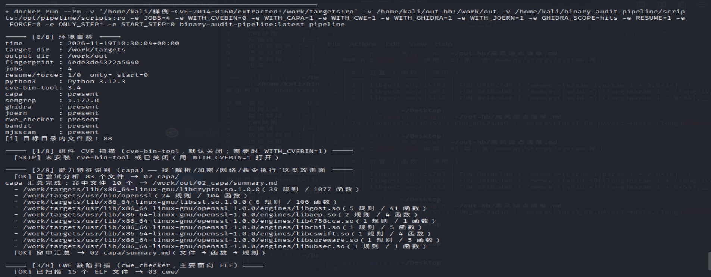
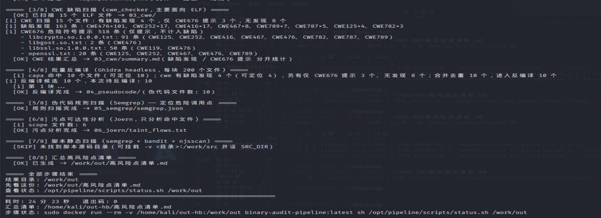
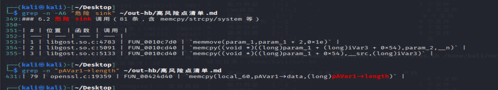

# 案例：OpenSSL 1.0.1c（Heartbleed 同版本）无源码审计

## 样本是什么

从 Ubuntu 12.04 官方归档下载的 `openssl` 二进制包，解包后得到：

```
lib/x86_64-linux-gnu/libssl.so.1.0.0
lib/x86_64-linux-gnu/libcrypto.so.1.0.0
usr/bin/openssl
usr/lib/x86_64-linux-gnu/openssl-1.0.0/engines/*.so
```

包名里的 `1.0.0` 是 Ubuntu 的 SONAME，实际版本看字符串：

```bash
strings libssl.so.1.0.0 | grep "OpenSSL 1"
# SSLv3 part of OpenSSL 1.0.1c 10 May 2012
# TLSv1 part of OpenSSL 1.0.1c 10 May 2012
```

也就是说这个样本的版本是 **1.0.1c**，属于 CVE-2014-0160（Heartbleed）的影响范围，
而且已经被 `strip`，没有任何符号表。

## 怎么跑

```bash
python3 audit.py /path/to/openssl-1.0.1c/extracted /path/to/out
```

默认关闭 CVE 扫描（第 1 步），开启 Joern（第 6 步）。

实测环境是 4 核 / 16GB 内存的虚拟机，完整 8 步耗时 **24 分 23 秒**。



## 跑出来的结果

目标目录共 88 个文件，每一步都在收敛范围：

| 步骤 | 结果 |
| --- | --- |
| 1. 组件 CVE（cve-bin-tool，默认关闭） | 跳过 |
| 2. 能力特征（capa） | 81 条命中，涉及 10 个文件 |
| 3. CWE 缺陷（cwe_checker） | 163 条；15 个 ELF 里 4 个有缺陷、3 个仅 CWE676 提示、8 个无发现 |
| 4. 反编译（Ghidra） | 命中文件去重后 10 个 → 8735 个函数 |
| 5. 伪代码规则（Semgrep） | 682 条命中 |
| 6. 污点路径（Joern） | 33 条可达路径（6 个文件进入复筛） |
| 7. 脚本扫描（Semgrep / Bandit / njsscan） | 跳过（样本里没有脚本） |
| 8. 汇总 | 81 条危险 sink |



## 6.2 危险 sink 表：Heartbleed 同形态的那一条

```bash
grep -n -A6 "危险 sink" out/高风险点清单.md
grep -n "pAVar1->length" out/高风险点清单.md
```

81 条里第 79 条就是：

```
| 79 | openssl.c:19359 | FUN_00424d40 | `memcpy(local_60,pAVar1->data,(long)pAVar1->length)` |
```



拷贝长度 `pAVar1->length` 直接来自结构体字段，和 Heartbleed 的形态
（长度字段来自报文、未经校验就传给 `memcpy`）一致。

## 这个案例能说明什么，不能说明什么

能说明：

- 对 stripped 的二进制，流水线能把 88 个文件收敛成 10 个反编译文件、8735 个函数，
  再收敛到 33 条污点路径和 81 条危险调用，其中第 79 条与 Heartbleed 同形态；
- 不需要源码、不需要运行样本；
- 4 核 / 16GB 上，整个目录 24 分钟跑完，每一步的原始结果都留在 `out/` 里。

不能说明：

- 这不是"自动发现了 CVE-2014-0160"。函数被 strip 后只剩 `FUN_00424d40` 这种名字，
  静态扫描只能给出行为线索，不能证明它就是 `tls1_process_heartbeat`；
- CVE 编号要靠第 1 步的 cve-bin-tool，本次是关闭状态，而且它按版本匹配，
  对 Ubuntu 打了补丁的包容易误报或漏报；
- 结论仍然需要人工顺着这条 `memcpy` 往上回溯，确认长度字段是否真的来自网络报文。

这也是这个项目的定位：它不是漏洞发现器，是把"该先看哪里"从 88 个文件缩短到一条调用。
